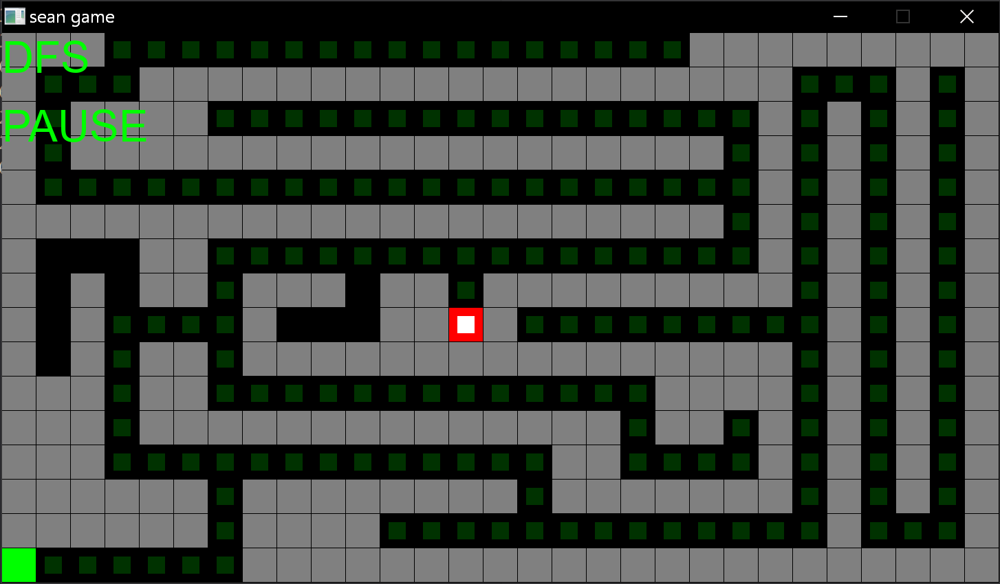
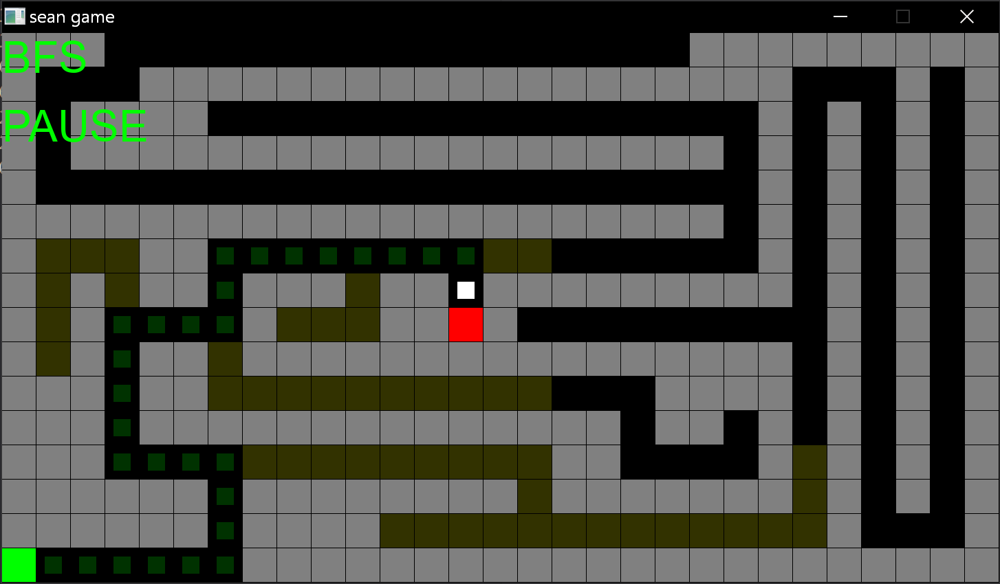
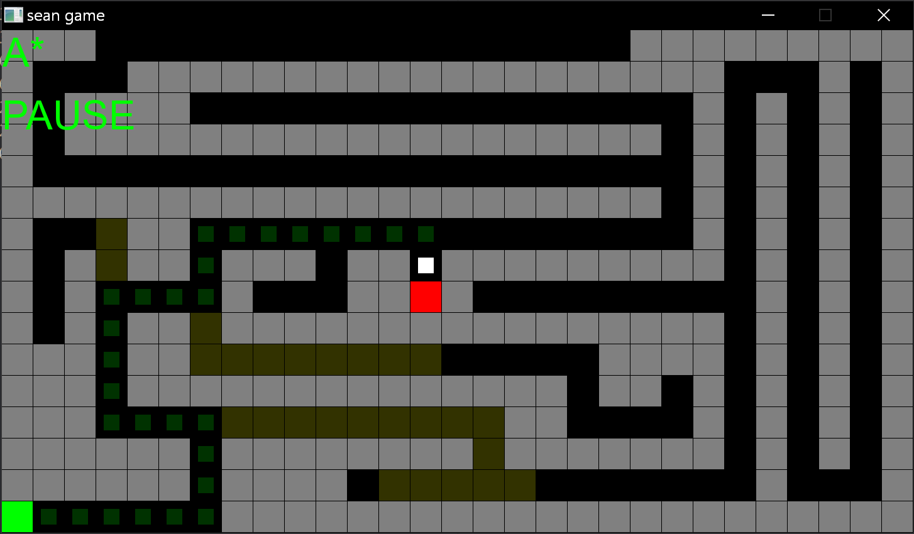

# Path Search
a simple dfs/bfs/a* path search project in c

## Build
## you should have a mingw64
make && make run

## Third
MingW64
SDL3
SDL3_ttf

## Demo
1.depth-first-search

2.breadth-first-search

3.a*-search
